 

---

## 👋 About Me

I'm a **BS Artificial Intelligence** student at **FAST NUCES**, working where machine learning meets interactive media. I like building systems that *learn*: game agents trained with reinforcement learning, worlds that generate themselves, and models that see.

- 🎯 **Focus:** reinforcement learning, procedural content generation, game AI
- 🔬 **Exploring:** generative AI, agentic systems, computer vision, deepfake detection
- 🎮 **Always tinkering with:** game dev, simulations, and creative coding
- 🐍 **Main languages:** Python and C++

---

## 🛠️ Tech Stack

| | |
|---|---|
| **Languages** | Python · C++ · JavaScript · C# · Dart · HTML/CSS |
| **AI / ML** | PyTorch · Reinforcement Learning · Computer Vision · NLP · Generative AI |
| **Game Dev** | Pygame · Procedural Generation · Game AI · Physics Simulation |
| **Tools** | Git · Jupyter / Colab · Electron · VS Code |

---

## 🚀 Featured Projects

<table>
  <tr>
    <td width="50%" valign="top">
      <h3>🧬 <a href="https://github.com/Rayan581/evo-game-ai-copilot">EVO</a></h3>
      
Agentic AI co-pilot for reinforcement learning experiments, with persistent memory and automated analysis.

      
      
      
    </td>
    <td width="50%" valign="top">
      <h3>🛡️ <a href="https://github.com/Rayan581/agdf">AGDF</a></h3>
      
Deepfake detection that swaps static branch averaging in GenConViT for an Adaptive Gated Decision Fusion module.

      
      
      
    </td>
  </tr>
  <tr>
    <td width="50%" valign="top">
      <h3>🏝️ <a href="https://github.com/Rayan581/island">Island</a></h3>
      
A Windows Dynamic Island desktop app built with Electron, showing Spotify music and lyrics plus Claude Code status.

      
      
    </td>
    <td width="50%" valign="top">
      <h3>♟️ <a href="https://github.com/Rayan581/Chess">Chess</a></h3>
      
Python and Pygame chess game with full rules, timers, sound, auto-flip, and PGN export.

      
      
    </td>
  </tr>
  <tr>
    <td width="50%" valign="top">
      <h3>🐤 <a href="https://github.com/Rayan581/Flappybird-AI">Flappybird-AI</a></h3>
      
Neural networks and genetic algorithms learn to dodge pipes on their own.

      
      
    </td>
    <td width="50%" valign="top">
      <h3>🐍 <a href="https://github.com/Rayan581/Snake-AI">Snake-AI</a></h3>
      
Play Snake yourself, or sit back and let the AI take over.

      
      
    </td>
  </tr>
  <tr>
    <td width="50%" valign="top">
      <h3>🦎 <a href="https://github.com/Rayan581/Creature-Evolution-Simulation">Creature Evolution Simulation</a></h3>
      
An evolutionary simulation where creatures adapt over generations.

      
      
    </td>
    <td width="50%" valign="top">
      <h3>📖 <a href="https://github.com/Rayan581/Urdu-Stories-Generation-Model">Urdu Stories Generation</a></h3>
      
Text generation model for Urdu stories, built with NLP concepts.

      
      
    </td>
  </tr>
</table>

<b>More projects</b>

 

- ⚡ [**gpu-bpe**](https://github.com/Rayan581/gpu-bpe): GPU-accelerated byte-pair encoding experiments
- ⚙️ [**physics-engine**](https://github.com/Rayan581/physics-engine): a physics engine in Python
- 📄 [**visual-doc-qa**](https://github.com/Rayan581/visual-doc-qa): visual document question answering
- 🚨 [**incidentzero**](https://github.com/Rayan581/incidentzero)
- 💬 [**service_based_conversational_ai_nlp**](https://github.com/Rayan581/service_based_conversational_ai_nlp): conversational AI with NLP
- 🎮 [**MiniJam-Snakes**](https://github.com/Rayan581/MiniJam-Snakes): game jam entry on the theme of Snakes
- 🕹️ Classic C++ games: [Pong](https://github.com/Rayan581/Pong) · [Blappy-Fird](https://github.com/Rayan581/Blappy-Fird)
- 🧮 [**Data-Structures-Lab**](https://github.com/Rayan581/Data-Structures-Lab): data structures in C++

---

## 📊 GitHub Stats

  

  

---

## 📫 Let's Connect

I'm always up for talking game AI, RL, or interesting side projects. Reach out anywhere below.

 

